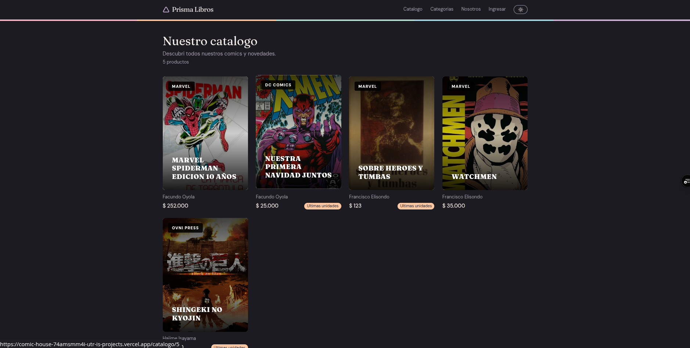
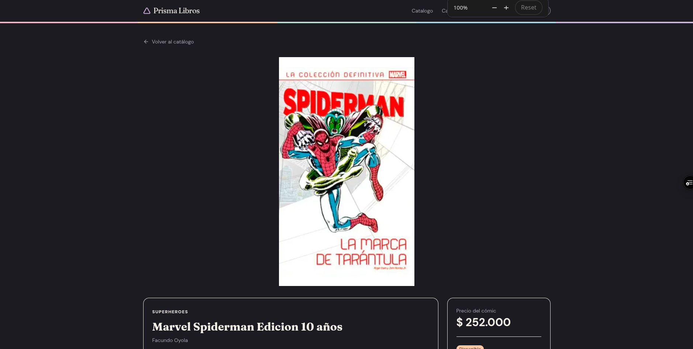
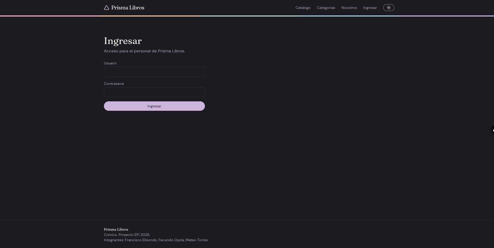
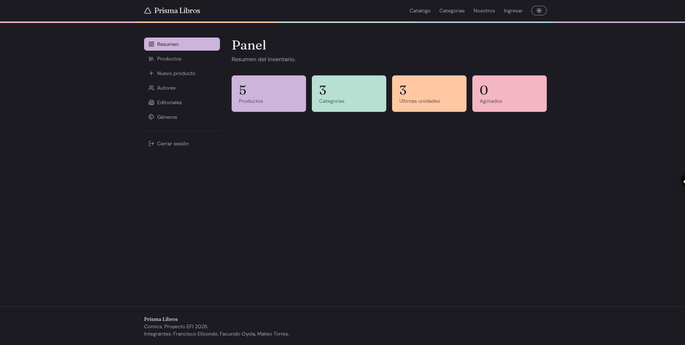
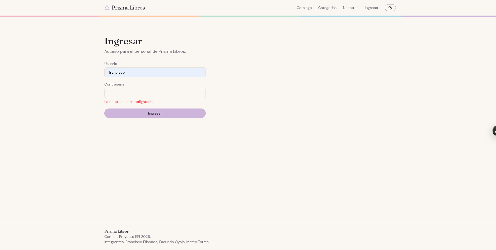
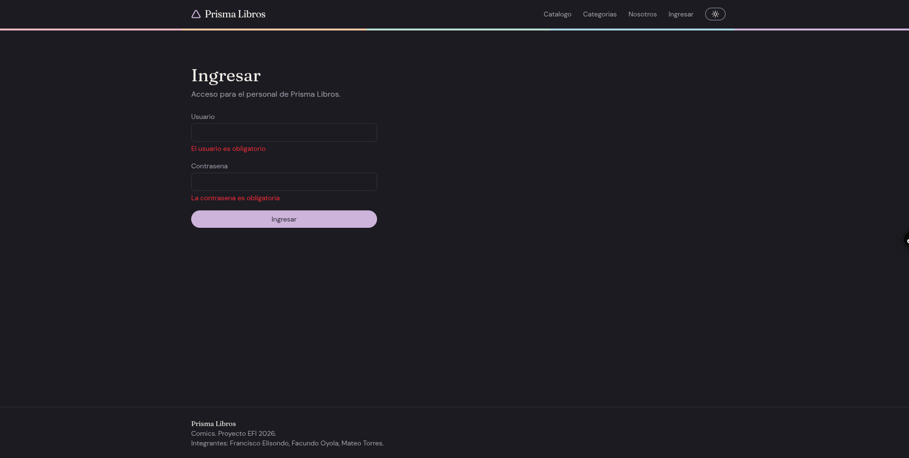

# Prisma Libros

Tienda online de comics. Aplicacion web desarrollada con **Next.js (App Router)** que consume la API REST del grupo, hecha con Django y Django REST Framework en Ingenieria de Software.

Proyecto del **Examen Final Integrador 2026** de Programacion III, Instituto Tecnologico Rio Cuarto (ITEC).

## Indice

- [Tematica](#tematica)
- [Enlaces](#enlaces)
- [Tecnologias](#tecnologias)
- [Funcionalidades](#funcionalidades)
- [Rutas](#rutas)
- [Arquitectura de componentes](#arquitectura-de-componentes)
- [Estructura del proyecto](#estructura-del-proyecto)
- [Ejecucion local](#ejecucion-local)
- [Variables de entorno](#variables-de-entorno)
- [Tests](#tests)
- [Despliegue](#despliegue)
- [Metodologia de trabajo](#metodologia-de-trabajo)
- [Cumplimiento del enunciado](#cumplimiento-del-enunciado)
- [Capturas](#capturas)
- [Integrantes](#integrantes)

## Tematica

Prisma Libros es una comiqueria online. Asi como un prisma separa la luz en todos sus colores, la tienda separa las historias en generos, autores y editoriales para que cada lector encuentre la suya.

El sistema tiene dos partes:

- **Zona publica:** catalogo con busqueda, filtros, orden y paginacion, detalle de cada comic y navegacion por categorias (generos).
- **Panel de administracion:** protegido con login. El personal puede ver, crear, editar y borrar comics, y gestionar autores, editoriales y generos.

**Identidad visual:** fondo papel calido, tinta oscura y una paleta pastel de cinco colores (lila, durazno, menta, celeste y rosa) que forman el espectro del prisma. El logo es el icono de un triangulo junto al nombre. Tipografias Fraunces (titulos) y DM Sans (cuerpo). Incluye modo claro y modo oscuro.

## Enlaces

| Recurso | Enlace |
|---|---|
| Aplicacion desplegada | https://comic-house.vercel.app |
| Repositorio del front | https://github.com/utr-i/ComicHouse |
| Repositorio de la API (Ingenieria de Software) | (https://github.com/Oyola2024/ComicHouse) |
| Documentacion de la API (Swagger) | (https://back-3y41.onrender.com/api/docs/swagger/) |

> El despliegue usa una copia del repositorio del Back, configurada para hosting (variables de entorno, `ALLOWED_HOSTS` y duracion del token). El codigo de la API es el mismo que el del repositorio oficial.

## Tecnologias

- Next.js 16 (App Router) y React
- TypeScript (TSX)
- Tailwind CSS
- React Hook Form y Zod (formularios y validaciones)
- Context API (tema claro y oscuro)
- Vitest y Testing Library (tests unitarios)
- lucide-react (iconos)
- Cloudinary (almacenamiento de las portadas)
- Vercel (despliegue)

## Funcionalidades

- Catalogo de comics con busqueda, filtro por categoria, orden por titulo o precio y paginacion. Los filtros viven en la URL, por lo que se pueden compartir.
- Detalle de cada comic con autor, editorial, fecha de publicacion, precio y estado de stock.
- Categorias (generos) con su propia pagina de comics.
- Portadas de los comics, con imagenes alojadas en Cloudinary.
- Login contra la API (token JWT) y cierre de sesion.
- Rutas del panel protegidas: sin sesion se redirige al login.
- CRUD completo de comics: crear, leer, editar y borrar (con confirmacion).
- Gestion de autores, editoriales y generos desde el panel.
- Formularios validados con Zod, que muestran tambien los errores que devuelve la API.
- Estados de carga (`loading.tsx`) y de error (`error.tsx`), y pagina 404 propia.
- Modo claro y oscuro con persistencia.

## Rutas

| Ruta | Descripcion |
|---|---|
| `/` | Inicio |
| `/catalogo` | Listado con busqueda, filtros, orden y paginacion |
| `/catalogo/[id]` | Detalle de un comic (ruta dinamica) |
| `/categorias` | Listado de categorias |
| `/categorias/[slug]` | Comics de una categoria (ruta dinamica) |
| `/nosotros` | Informacion de la tienda |
| `/login` | Ingreso al panel |
| `/dashboard` | Resumen del inventario (protegida) |
| `/dashboard/productos` | Tabla de comics (anidada) |
| `/dashboard/productos/nuevo` | Alta de comic (anidada) |
| `/dashboard/productos/[id]/editar` | Edicion de comic (anidada y dinamica) |
| `/dashboard/autores` | Gestion de autores (anidada) |
| `/dashboard/editoriales` | Gestion de editoriales (anidada) |
| `/dashboard/generos` | Gestion de generos (anidada) |

Hay un **layout raiz** (fuentes, tema, navbar y footer) y un **layout anidado** para `/dashboard` (barra lateral). La navegacion interna usa el componente `Link` de Next.js.

## Arquitectura de componentes

Todo es **Server Component** por defecto. Se usa `use client` solo cuando el componente necesita estado, eventos, hooks del navegador o contexto.

| Tipo | Componentes | Motivo |
|---|---|---|
| Server | Navbar, Footer, ProductCard, ProductGrid, ProductTable, Badge, Pagination, CategoryCard, FormField y las paginas | Solo muestran datos, sin estado ni eventos. Las paginas piden datos a la API con `async/await` |
| Client | ThemeProvider, ThemeToggle, SearchFilters, LoginForm, ProductForm, DeleteButton, Sidebar y los `error.tsx` | Usan estado, eventos, `useRouter`, `usePathname`, `localStorage` o React Hook Form. Next exige que `error.tsx` sea Client |

Las llamadas a la API salen desde el servidor de Next (Server Components y Server Actions). El token se guarda en una cookie `httpOnly`, por lo que el JavaScript del navegador nunca lo ve. Las rutas del panel se protegen con `src/proxy.ts`, y las Server Actions vuelven a verificar la sesion.

## Estructura del proyecto

```
src/
  app/
    actions/          Server Actions (login, logout y CRUD)
    catalogo/         listado, detalle, loading y error
    categorias/       listado y detalle por slug
    dashboard/        layout con sidebar, resumen, comics, autores, editoriales y generos
    login/  nosotros/  sesion-expirada/
    layout.tsx  page.tsx  not-found.tsx  globals.css
  components/         componentes reutilizables
  context/            ThemeContext
  lib/                api.ts, auth.ts, config.ts, colors.ts, format.ts, schemas.ts
  types/              tipos TypeScript
  proxy.ts            proteccion de rutas
test/                 tests unitarios (Vitest)
```

## Ejecucion local

### Requisitos

- Node.js 20 o superior y npm
- La API del Back corriendo (local o publicada)

### Pasos

1. Clonar el repositorio e instalar las dependencias:

```bash
git clone https://github.com/utr-i/ComicHouse.git
cd ComicHouse
npm install
```

2. Crear el archivo de variables de entorno a partir del ejemplo:

```bash
cp .env.example .env.local
```

3. Levantar la API del Back (ver el README del repositorio de la API). Con `uv`, desde la carpeta del Back:

```bash
uv sync
cd src
uv run manage.py migrate
uv run manage.py runserver
```

4. Levantar el front:

```bash
npm run dev
```

La aplicacion queda disponible en http://localhost:3000.

### Acceso al panel

Para entrar al panel (`/login`) hace falta un usuario del Back, por ejemplo un superusuario creado con `uv run manage.py createsuperuser`.

COMPLETAR: usuario de prueba para la defensa (usuario y contrasena de prueba, que no se usen en ningun otro sitio).

## Variables de entorno

| Variable | Descripcion | Ejemplo |
|---|---|---|
| `API_URL` | URL base de la API, terminada en `/api` y sin barra final | `http://127.0.0.1:8000/api` |

`API_URL` es una variable solo de servidor (sin prefijo `NEXT_PUBLIC_`), porque todas las llamadas a la API salen desde el servidor de Next. En produccion se configura en Vercel con la URL publica del Back, por ejemplo `https://MI-BACK.onrender.com/api`. Si se cambia, hay que volver a desplegar.

Las portadas se alojan en Cloudinary. COMPLETAR: nombre de las variables de Cloudinary que usa el proyecto (en el front y/o en el Back) y donde se configuran. Nunca se suben los valores reales al repositorio.

El archivo `.env.local` esta en el `.gitignore`; el repositorio incluye `.env.example` como referencia.

## Tests

Los tests unitarios usan **Vitest** con jsdom. Para correrlos:

```bash
npm run test
```

Cubren:

- Funciones utilitarias: `formatPrecio` (formato en pesos argentinos), `etiquetaStock` y `slugify`.
- Esquemas de validacion de Zod: `loginSchema` y `productoSchema` (casos validos e invalidos).

La configuracion esta en `vitest.config.ts` y `vitest.setup.ts`.

## Despliegue

El front esta desplegado en **Vercel** y la API del Back esta publicada en un servidor accesible desde internet (no apunta a `localhost`).

Para desplegar:

1. Importar el repositorio en Vercel (rama de produccion `main`).
2. Cargar la variable de entorno `API_URL` con la URL publica del Back.
3. Desplegar. Cada push a `main` vuelve a desplegar automaticamente.

## Metodologia de trabajo

- **GitFlow:** ramas `main` (entregas estables), `develop` (integracion) y `feature/*` (una por tarea), con Pull Requests hacia `develop`.
- Commits descriptivos con prefijos (`feat`, `fix`, `test`, `chore`, `docs`).
- Tablero Kanban con las tareas asignadas a los integrantes (ver enlace en la seccion de enlaces).

## Cumplimiento del enunciado

| Requisito | Donde se cumple |
|---|---|
| R1. Enrutamiento y layouts | Mas de 6 rutas principales, rutas anidadas (`/dashboard/...`), dos rutas dinamicas (`/catalogo/[id]` y `/categorias/[slug]`), `Link`, layout raiz y layout del dashboard, `not-found.tsx`, `loading.tsx` y `error.tsx` en catalogo y dashboard |
| R2. Componentes | Mas de 8 componentes reutilizables, con Server y Client Components justificados (tabla de arquitectura) |
| R3. API y CRUD | Consumo de la API propia, CRUD completo de comics, listado con busqueda, filtros, orden y paginacion, estados de carga y error |
| R4. Autenticacion | Login con token JWT de la API, cierre de sesion, rutas protegidas con `proxy.ts` y redireccion al login |
| R5. Formularios | React Hook Form con Zod y `zodResolver`, en login y en el formulario de comics, con errores de validacion y de la API |
| R6. Estado global | `ThemeContext` con `createContext` y `useContext` (tema claro y oscuro) |
| R7. Testing | Vitest configurado, con tests unitarios de utilidades y esquemas de validacion |
| R8. Despliegue | Vercel, con `API_URL` configurada y API del Back publicada |

## Capturas

| Catalogo | Detalle de un comic |
|---|---|
|  |  |

| Login | Panel de administracion |
|---|---|
|  |  |

| Formulario con validaciones | Modo oscuro |
|---|---|
|  |  |

## Integrantes

- Francisco Elisondo
- Facundo Oyola
- Mateo Torres
